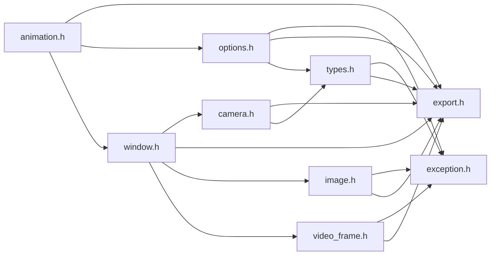

# File animation.h {/* #animation_8h */}

![][C++]

**Location**: `animation.h`


## Classes

* [f3d::animation](classf3d_1_1animation.md)

## Namespaces

* [f3d](namespacef3d.md)

## Includes

* export.h
* [options.h](options_8h.md)
* [window.h](window_8h.md)





## Included by

* [scene.h](scene_8h.md)


## Source


```cpp
#ifndef f3d_animation_h
#define f3d_animation_h

#include "export.h"
#include "options.h"
#include "window.h"

namespace f3d
{
class F3D_EXPORT animation
{
public:
  virtual animation& loadTime(double timeValue) = 0;

  [[nodiscard]] virtual std::pair<double, double> getTimeRange() = 0;

  [[nodiscard]] virtual std::vector<double> getKeyFrames() = 0;

  [[nodiscard]] virtual unsigned int count() const = 0;

  [[nodiscard]] virtual std::string getName(std::optional<int> index = std::nullopt) const = 0;

  [[nodiscard]] virtual std::vector<std::string> getNames() const = 0;

  enum class Direction : std::uint8_t
  {
    FORWARD,
    BACKWARD
  };

  virtual animation& toggle(Direction direction = Direction::FORWARD) = 0;

  virtual animation& start(Direction direction = Direction::FORWARD) = 0;

  virtual animation& stop() = 0;

  [[nodiscard]] virtual bool isPlaying() = 0;

  [[nodiscard]] virtual animation::Direction getDirection() = 0;

protected:
  animation() = default;
  virtual ~animation() = default;
  animation(const animation& opt) = delete;
  animation(animation&& opt) = delete;
  animation& operator=(const animation& opt) = delete;
  animation& operator=(animation&& opt) = delete;
};
}

#endif
```


[public]: https://img.shields.io/badge/-public-brightgreen (public)
[C++]: https://img.shields.io/badge/language-C%2B%2B-blue (C++)
[const]: https://img.shields.io/badge/-const-lightblue (const)
[protected]: https://img.shields.io/badge/-protected-yellow (protected)
[static]: https://img.shields.io/badge/-static-lightgrey (static)
[private]: https://img.shields.io/badge/-private-red (private)