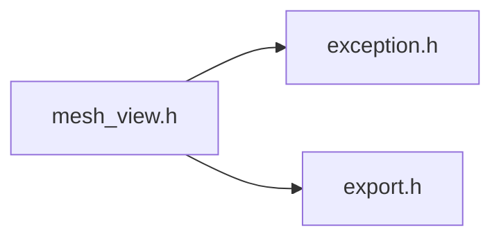

# File mesh_view.h {/* #mesh__view_8h */}

![][C++]

**Location**: `mesh\_view.h`


## Classes

* [f3d::mesh\_view](classf3d_1_1mesh__view.md)
* [f3d::mesh\_view::data\_array\_t](structf3d_1_1mesh__view_1_1data__array__t.md)
* [f3d::mesh\_view::cell\_array\_t](structf3d_1_1mesh__view_1_1cell__array__t.md)
* [f3d::mesh\_view::memory\_view\_t](structf3d_1_1mesh__view_1_1memory__view__t.md)

## Namespaces

* [f3d](namespacef3d.md)

## Includes

* [exception.h](exception_8h.md)
* export.h





## Included by

* [scene.h](scene_8h.md)


## Source


```cpp
#ifndef f3d_mesh_view_h
#define f3d_mesh_view_h

#include "exception.h"
#include "export.h"

#include <array>
#include <cstdint>
#include <string>
#include <vector>

namespace f3d
{
class F3D_EXPORT mesh_view
{
public:
  [[nodiscard]] virtual std::pair<double, double> getTimeRange() const
  {
    return { 0.0, 0.0 };
  }

  [[nodiscard]] virtual std::string getName() const
  {
    return "";
  }

  virtual bool buffersNeedUpdate() const
  {
    return false;
  }

  virtual void buffersUpdated()
  {
  }

  enum class data_type : uint8_t
  {
    U8,
    I8,
    U16,
    I16,
    U32,
    I32,
    U64,
    I64,
    F32,
    F64
  };

  template<typename Functor>
  static decltype(auto) dataTypeDispatch(f3d::mesh_view::data_type t, Functor&& f)
  {
    switch (t)
    {
      case f3d::mesh_view::data_type::U8:
        return f.template operator()<uint8_t>();
      case f3d::mesh_view::data_type::I8:
        return f.template operator()<int8_t>();
      case f3d::mesh_view::data_type::U16:
        return f.template operator()<uint16_t>();
      case f3d::mesh_view::data_type::I16:
        return f.template operator()<int16_t>();
      case f3d::mesh_view::data_type::U32:
        return f.template operator()<uint32_t>();
      case f3d::mesh_view::data_type::I32:
        return f.template operator()<int32_t>();
      case f3d::mesh_view::data_type::U64:
        return f.template operator()<uint64_t>();
      case f3d::mesh_view::data_type::I64:
        return f.template operator()<int64_t>();
      case f3d::mesh_view::data_type::F32:
        return f.template operator()<float>();
      case f3d::mesh_view::data_type::F64:
      default:
        return f.template operator()<double>();
    }
  }

  struct data_array_t
  {
    std::string name;
    data_type type = data_type::F32;
    const void* data = nullptr;
    size_t components = 1;
    size_t stride = 1;
    bool timeDependent = true;
  };

  struct cell_array_t
  {
    size_t offsetCount = 1;
    data_array_t offsets;
    size_t indexCount = 0;
    data_array_t indices;
  };

  struct memory_view_t
  {
    // points
    size_t pointCount = 0;
    data_array_t points;
    data_array_t normals;
    data_array_t textureCoordinates;

    // cells
    cell_array_t vertices;
    cell_array_t lines;
    cell_array_t polygons;

    // scalars
    std::vector<data_array_t> pointScalars;
    std::vector<data_array_t> cellScalars;
  };

  [[nodiscard]] virtual memory_view_t getMemoryView(double time) const = 0;

  mesh_view() = default;
  virtual ~mesh_view() = default;
  mesh_view(const mesh_view&) = delete;
  mesh_view(mesh_view&&) = delete;
  mesh_view& operator=(const mesh_view&) = delete;
  mesh_view& operator=(mesh_view&&) = delete;
};
}

#endif
```


[public]: https://img.shields.io/badge/-public-brightgreen (public)
[C++]: https://img.shields.io/badge/language-C%2B%2B-blue (C++)
[const]: https://img.shields.io/badge/-const-lightblue (const)
[protected]: https://img.shields.io/badge/-protected-yellow (protected)
[static]: https://img.shields.io/badge/-static-lightgrey (static)
[private]: https://img.shields.io/badge/-private-red (private)