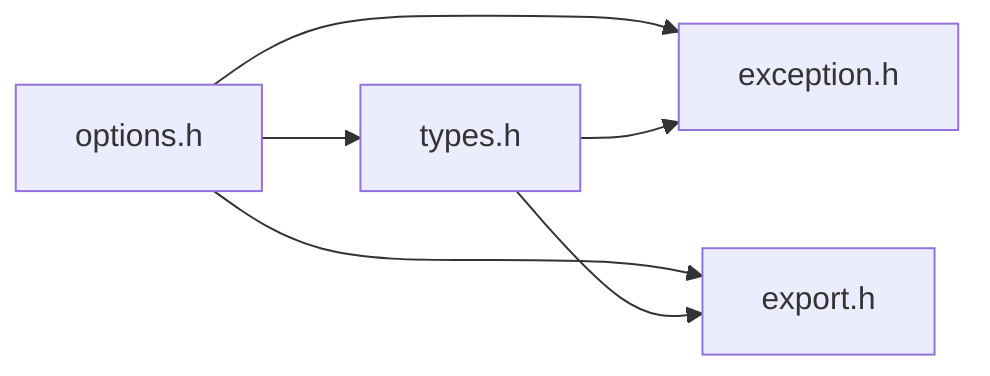
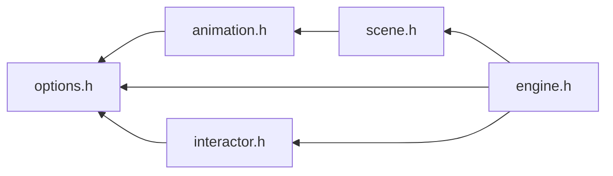

# File options.h {/* #options_8h */}

![][C++]

**Location**: `options.h`


## Classes

* [f3d::options](classf3d_1_1options.md)
* [f3d::options::DomainRange](structf3d_1_1options_1_1DomainRange.md)
* [f3d::options::DomainEnum](structf3d_1_1options_1_1DomainEnum.md)
* [f3d::options::DomainIndex](structf3d_1_1options_1_1DomainIndex.md)
* [f3d::options::parsing\_exception](structf3d_1_1options_1_1parsing__exception.md)
* [f3d::options::incompatible\_exception](structf3d_1_1options_1_1incompatible__exception.md)
* [f3d::options::inexistent\_exception](structf3d_1_1options_1_1inexistent__exception.md)
* [f3d::options::no\_value\_exception](structf3d_1_1options_1_1no__value__exception.md)
* [f3d::options::interactor](structf3d_1_1options_1_1interactor.md)
* [f3d::options::model](structf3d_1_1options_1_1model.md)
* [f3d::options::model::checkerboard](structf3d_1_1options_1_1model_1_1checkerboard.md)
* [f3d::options::model::color](structf3d_1_1options_1_1model_1_1color.md)
* [f3d::options::model::emissive](structf3d_1_1options_1_1model_1_1emissive.md)
* [f3d::options::model::matcap](structf3d_1_1options_1_1model_1_1matcap.md)
* [f3d::options::model::material](structf3d_1_1options_1_1model_1_1material.md)
* [f3d::options::model::normal](structf3d_1_1options_1_1model_1_1normal.md)
* [f3d::options::model::normal\_glyphs](structf3d_1_1options_1_1model_1_1normal__glyphs.md)
* [f3d::options::model::point\_sprites](structf3d_1_1options_1_1model_1_1point__sprites.md)
* [f3d::options::model::scivis](structf3d_1_1options_1_1model_1_1scivis.md)
* [f3d::options::model::volume](structf3d_1_1options_1_1model_1_1volume.md)
* [f3d::options::render](structf3d_1_1options_1_1render.md)
* [f3d::options::render::armature](structf3d_1_1options_1_1render_1_1armature.md)
* [f3d::options::render::axes\_grid](structf3d_1_1options_1_1render_1_1axes__grid.md)
* [f3d::options::render::background](structf3d_1_1options_1_1render_1_1background.md)
* [f3d::options::render::effect](structf3d_1_1options_1_1render_1_1effect.md)
* [f3d::options::render::effect::antialiasing](structf3d_1_1options_1_1render_1_1effect_1_1antialiasing.md)
* [f3d::options::render::effect::blending](structf3d_1_1options_1_1render_1_1effect_1_1blending.md)
* [f3d::options::render::grid](structf3d_1_1options_1_1render_1_1grid.md)
* [f3d::options::render::hdri](structf3d_1_1options_1_1render_1_1hdri.md)
* [f3d::options::render::light](structf3d_1_1options_1_1render_1_1light.md)
* [f3d::options::render::raytracing](structf3d_1_1options_1_1render_1_1raytracing.md)
* [f3d::options::scene](structf3d_1_1options_1_1scene.md)
* [f3d::options::scene::animation](structf3d_1_1options_1_1scene_1_1animation.md)
* [f3d::options::scene::camera](structf3d_1_1options_1_1scene_1_1camera.md)
* [f3d::options::ui](structf3d_1_1options_1_1ui.md)
* [f3d::options::ui::backdrop](structf3d_1_1options_1_1ui_1_1backdrop.md)
* [f3d::options::ui::drop\_zone](structf3d_1_1options_1_1ui_1_1drop__zone.md)
* [f3d::options::ui::notifications](structf3d_1_1options_1_1ui_1_1notifications.md)
* [f3d::options::ui::scene\_hierarchy](structf3d_1_1options_1_1ui_1_1scene__hierarchy.md)
* [f3d::options::domains](structf3d_1_1options_1_1domains.md)
* [f3d::options::domains::interactor](structf3d_1_1options_1_1domains_1_1interactor.md)
* [f3d::options::domains::model](structf3d_1_1options_1_1domains_1_1model.md)
* [f3d::options::domains::model::checkerboard](structf3d_1_1options_1_1domains_1_1model_1_1checkerboard.md)
* [f3d::options::domains::model::color](structf3d_1_1options_1_1domains_1_1model_1_1color.md)
* [f3d::options::domains::model::emissive](structf3d_1_1options_1_1domains_1_1model_1_1emissive.md)
* [f3d::options::domains::model::matcap](structf3d_1_1options_1_1domains_1_1model_1_1matcap.md)
* [f3d::options::domains::model::material](structf3d_1_1options_1_1domains_1_1model_1_1material.md)
* [f3d::options::domains::model::normal](structf3d_1_1options_1_1domains_1_1model_1_1normal.md)
* [f3d::options::domains::model::normal\_glyphs](structf3d_1_1options_1_1domains_1_1model_1_1normal__glyphs.md)
* [f3d::options::domains::model::point\_sprites](structf3d_1_1options_1_1domains_1_1model_1_1point__sprites.md)
* [f3d::options::domains::model::scivis](structf3d_1_1options_1_1domains_1_1model_1_1scivis.md)
* [f3d::options::domains::model::volume](structf3d_1_1options_1_1domains_1_1model_1_1volume.md)
* [f3d::options::domains::render](structf3d_1_1options_1_1domains_1_1render.md)
* [f3d::options::domains::render::armature](structf3d_1_1options_1_1domains_1_1render_1_1armature.md)
* [f3d::options::domains::render::axes\_grid](structf3d_1_1options_1_1domains_1_1render_1_1axes__grid.md)
* [f3d::options::domains::render::background](structf3d_1_1options_1_1domains_1_1render_1_1background.md)
* [f3d::options::domains::render::effect](structf3d_1_1options_1_1domains_1_1render_1_1effect.md)
* [f3d::options::domains::render::effect::antialiasing](structf3d_1_1options_1_1domains_1_1render_1_1effect_1_1antialiasing.md)
* [f3d::options::domains::render::effect::blending](structf3d_1_1options_1_1domains_1_1render_1_1effect_1_1blending.md)
* [f3d::options::domains::render::grid](structf3d_1_1options_1_1domains_1_1render_1_1grid.md)
* [f3d::options::domains::render::hdri](structf3d_1_1options_1_1domains_1_1render_1_1hdri.md)
* [f3d::options::domains::render::light](structf3d_1_1options_1_1domains_1_1render_1_1light.md)
* [f3d::options::domains::render::raytracing](structf3d_1_1options_1_1domains_1_1render_1_1raytracing.md)
* [f3d::options::domains::scene](structf3d_1_1options_1_1domains_1_1scene.md)
* [f3d::options::domains::scene::animation](structf3d_1_1options_1_1domains_1_1scene_1_1animation.md)
* [f3d::options::domains::scene::camera](structf3d_1_1options_1_1domains_1_1scene_1_1camera.md)
* [f3d::options::domains::ui](structf3d_1_1options_1_1domains_1_1ui.md)
* [f3d::options::domains::ui::backdrop](structf3d_1_1options_1_1domains_1_1ui_1_1backdrop.md)
* [f3d::options::domains::ui::drop\_zone](structf3d_1_1options_1_1domains_1_1ui_1_1drop__zone.md)
* [f3d::options::domains::ui::notifications](structf3d_1_1options_1_1domains_1_1ui_1_1notifications.md)
* [f3d::options::domains::ui::scene\_hierarchy](structf3d_1_1options_1_1domains_1_1ui_1_1scene__hierarchy.md)

## Namespaces

* [f3d](namespacef3d.md)

## Includes

* [exception.h](exception_8h.md)
* export.h
* [types.h](types_8h.md)





## Included by

* [animation.h](animation_8h.md)
* [engine.h](engine_8h.md)
* [interactor.h](interactor_8h.md)





## Functions

### Function operator\<\< {/* #options_8h_1ae45474fc5074fe195869b53d2a5429c1 */}

![][public]


```cpp
std::ostream & operator<<(std::ostream &os, const f3d::color_t &color)
```


**Parameters**:

* std::ostream & **os**
* const [f3d::color\_t](classf3d_1_1color__t.md) & **color**

**Return type**: std::ostream &

### Function operator\<\< {/* #options_8h_1a787081c010d4258cf01a9d7e4c0fdc1a */}

![][public]


```cpp
std::ostream & operator<<(std::ostream &os, const f3d::direction_t &direction)
```


**Parameters**:

* std::ostream & **os**
* const [f3d::direction\_t](classf3d_1_1direction__t.md) & **direction**

**Return type**: std::ostream &

### Function operator\<\< {/* #options_8h_1a9ac8e9c6c6a4dab9c5d3479c457f136d */}

![][public]


```cpp
std::ostream & operator<<(std::ostream &os, const f3d::colormap_t &cm)
```


**Parameters**:

* std::ostream & **os**
* const [f3d::colormap\_t](classf3d_1_1colormap__t.md) & **cm**

**Return type**: std::ostream &

### Function operator\<\< {/* #options_8h_1a690455850de66a7a03be6b3208cb16a4 */}

![][public]


```cpp
std::ostream & operator<<(std::ostream &os, const f3d::transform2d_t &transform)
```


**Parameters**:

* std::ostream & **os**
* const [f3d::transform2d\_t](classf3d_1_1transform2d__t.md) & **transform**

**Return type**: std::ostream &

## Source


```cpp
#ifndef f3d_options_h
#define f3d_options_h

#include "exception.h"
#include "export.h"
#include "types.h"

#include <array>
#include <cstdint>
#include <filesystem>
#include <optional>
#include <string>
#include <variant>
#include <vector>

namespace f3d
{
// Declared here for simplicity
using option_variant_t =
  std::variant<bool, int, double, std::string, std::vector<double>, std::vector<int>>;

class F3D_EXPORT options
{
public:
  enum class F3D_EXPORT domain_style : std::uint8_t
  {
    RANGE = 1,
    ENUM = 2,
    INDEX = 3,
  };

  enum class F3D_EXPORT option_type : std::uint8_t
  {
    BOOL,
    INT,
    DOUBLE,
    RATIO,
    STRING,
    PATH,
    COLOR,
    DIRECTION,
    COLORMAP,
    TRANSFORM2D,
    DOUBLE_VECTOR,
    INT_VECTOR
  };

  template<typename T>
  struct DomainRange
  {
    T min;
    T max;
    T increment;
  };

  template<typename T>
  struct DomainEnum
  {
    std::vector<T> enumeration;
  };

  struct DomainIndex
  {
    std::optional<unsigned int> max;
  };


  options();
  ~options();
  options(const options& opt);
  options& operator=(const options& opt);
  options(options&& other) noexcept;
  options& operator=(options&& other) noexcept;

  options& set(std::string_view name, const option_variant_t& value);

  [[nodiscard]] option_variant_t get(std::string_view name) const;

  options& setAsString(std::string_view name, const std::string& str);

  [[nodiscard]] std::string getAsString(std::string_view name) const;

  options& toggle(std::string_view name);

  [[nodiscard]] bool isSame(const options& other, std::string_view name) const;

  [[nodiscard]] bool hasValue(std::string_view name) const;

  options& copy(const options& other, std::string_view name);

  [[nodiscard]] static std::vector<std::string> getAllNames();

  [[nodiscard]] std::vector<std::string> getNames() const;

  [[nodiscard]] option_type getType(std::string_view name) const;

  [[nodiscard]] std::pair<std::string, unsigned int> getClosestOption(
    std::string_view option) const;

  [[nodiscard]] bool isOptional(std::string_view option) const;

  options& reset(std::string_view name);

  options& removeValue(std::string_view name);

  [[nodiscard]] bool hasDomain(std::string_view name) const;

  [[nodiscard]] domain_style getDomainStyle(std::string_view name) const;

  [[nodiscard]] DomainRange<option_variant_t> getRangeDomain(std::string_view name) const;

  [[nodiscard]] DomainEnum<option_variant_t> getEnumDomain(std::string_view name) const;

  [[nodiscard]] DomainIndex getIndexDomain(std::string_view name) const;

  options& increase(std::string_view name);

  options& decrease(std::string_view name);

  options& cycle(std::string_view name);

  template<typename T>
  [[nodiscard]] static T parse(const std::string& str);

  template<typename T>
  [[nodiscard]] static std::string format(const T& var);

  struct parsing_exception : public exception
  {
    explicit parsing_exception(const std::string& what = "");
  };

  struct incompatible_exception : public exception
  {
    explicit incompatible_exception(const std::string& what = "");
  };

  struct inexistent_exception : public exception
  {
    explicit inexistent_exception(const std::string& what = "");
  };

  struct no_value_exception : public exception
  {
    explicit no_value_exception(const std::string& what = "");
  };

  // clang-format off
    struct interactor {
    bool invert_zoom = false;
    std::string style = "default";
  } interactor;

  struct model {
    struct checkerboard {
      bool enable = false;
    } checkerboard;

    struct color {
      std::optional<double> opacity;
      std::optional<f3d::color_t> rgb;
      std::optional<std::filesystem::path> texture;
    } color;

    std::string coloring = "material";
    struct emissive {
      std::optional<f3d::color_t> factor;
      std::optional<std::filesystem::path> texture;
    } emissive;

    struct matcap {
      std::optional<std::filesystem::path> texture;
    } matcap;

    struct material {
      std::optional<double> base_ior;
      std::optional<double> metallic;
      std::optional<double> roughness;
      std::optional<std::filesystem::path> texture;
    } material;

    struct normal {
      std::optional<double> scale;
      std::optional<std::filesystem::path> texture;
    } normal;

    struct normal_glyphs {
      bool enable = false;
      f3d::ratio_t scale = f3d::ratio_t{1.0};
    } normal_glyphs;

    struct point_sprites {
      bool absolute_size = false;
      double size = 10.0;
      std::string type = "none";
    } point_sprites;

    struct scivis {
      std::optional<std::string> array_name;
      f3d::colormap_t colormap = f3d::colormap_t{0.0, 0.0, 0.0, 0.0, 0.4, 0.9, 0.0, 0.0, 0.8, 0.9, 0.9, 0.0, 1.0, 1.0, 1.0, 1.0};
      std::optional<int> component;
      std::optional<int> discretization;
      std::string field = "any";
      std::vector<double> opacity_map = {0.0, 0.0, 1.0, 1.0};
      std::optional<std::vector<double>> range;
    } scivis;

    std::optional<f3d::transform2d_t> textures_transform;
    std::optional<bool> unlit;
    struct volume {
      bool enable = false;
      bool inverse = false;
    } volume;

  } model;

  struct render {
    struct armature {
      bool enable = false;
    } armature;

    struct axes_grid {
      bool enable = false;
    } axes_grid;

    std::optional<std::string> backface_type;
    struct background {
      double blur_coc = 20.0;
      f3d::color_t color = f3d::color_t{0.2, 0.2, 0.2};
      std::string skybox = "disabled";
    } background;

    struct effect {
      bool ambient_occlusion = false;
      struct antialiasing {
        std::string mode = "none";
      } antialiasing;

      struct blending {
        std::string mode = "none";
      } blending;

      bool display_depth = false;
      std::optional<std::string> final_shader;
      bool tone_mapping = false;
    } effect;

    struct grid {
      bool absolute = false;
      f3d::color_t color = f3d::color_t{0.0, 0.0, 0.0};
      bool enable = false;
      f3d::ratio_t opacity = f3d::ratio_t{1.0};
      f3d::ratio_t reflection = f3d::ratio_t{0.0};
      int subdivisions = 10;
      std::optional<double> unit;
    } grid;

    struct hdri {
      bool ambient = false;
      std::optional<std::filesystem::path> file;
    } hdri;

    struct light {
      double intensity = 1.0;
    } light;

    std::optional<double> line_width;
    std::optional<double> point_size;
    struct raytracing {
      bool denoise = false;
      bool enable = false;
      int samples = 5;
    } raytracing;

    std::optional<bool> show_edges;
  } render;

  struct scene {
    struct animation {
      bool autoplay = false;
      std::vector<int> indices = {0};
      f3d::ratio_t speed_factor = f3d::ratio_t{1.0};
    } animation;

    struct camera {
      std::optional<int> index;
      std::optional<bool> orthographic;
    } camera;

    std::optional<std::string> force_reader;
    bool skip_content_check = false;
    f3d::direction_t up_direction = f3d::direction_t{0,1,0};
  } scene;

  struct ui {
    std::string animation_progress = "none";
    f3d::color_t animation_progress_color = options::parse<f3d::color_t>("f3d_blue");
    bool axis = false;
    struct backdrop {
      f3d::color_t color = options::parse<f3d::color_t>("f3d_black");
      double opacity = 0.9;
    } backdrop;

    bool cheatsheet = false;
    bool console = false;
    bool dpi_aware = false;
    struct drop_zone {
      std::string custom_binds = "";
      bool enable = false;
      bool show_logo = false;
    } drop_zone;

    bool filename = false;
    std::string filename_info = "";
    f3d::color_t font_color = options::parse<f3d::color_t>("f3d_white");
    std::optional<std::filesystem::path> font_file;
    bool fps = false;
    bool hdri_filename = false;
    bool loader_progress = false;
    f3d::color_t loader_progress_color = options::parse<f3d::color_t>("f3d_yellow");
    bool metadata = false;
    bool minimal_console = false;
    struct notifications {
      bool enable = false;
      bool show_bindings = false;
    } notifications;

    bool scalar_bar = false;
    f3d::ratio_t scale = f3d::ratio_t{1.0};
    struct scene_hierarchy {
      bool enable = false;
      int max_width = 600;
    } scene_hierarchy;

    f3d::color_t x_color = options::parse<f3d::color_t>("f3d_red");
    f3d::color_t y_color = options::parse<f3d::color_t>("f3d_green");
    f3d::color_t z_color = options::parse<f3d::color_t>("f3d_blue");
  } ui;


  // clang-format on

  // clang-format off
  struct domains {
      struct interactor {
      DomainEnum<std::string> style = {{"default", "trackball", "2d", }};
    } interactor;

    struct model {
      struct checkerboard {
      } checkerboard;

      struct color {
        DomainRange<double> opacity = {0.0, 1.0, 0.05};
      } color;

      DomainEnum<std::string> coloring = {{"material", "scivis", "direct", }};
      struct emissive {
      } emissive;

      struct matcap {
      } matcap;

      struct material {
        DomainRange<double> base_ior = {1.0, 2.5, 0.1};
        DomainRange<double> metallic = {0.0, 1.0, 0.05};
        DomainRange<double> roughness = {0.0, 1.0, 0.05};
      } material;

      struct normal {
        DomainRange<double> scale = {0.0, 3.0, 0.1};
      } normal;

      struct normal_glyphs {
        DomainRange<f3d::ratio_t> scale = {f3d::ratio_t(0.0), f3d::ratio_t(10.0), f3d::ratio_t(0.1)};
      } normal_glyphs;

      struct point_sprites {
        DomainRange<double> size = {1, 100, 1};
        DomainEnum<std::string> type = {{"none", "sphere", "gaussian", "circle", "stddev", "bound", "cross", }};
      } point_sprites;

      struct scivis {
        DomainRange<int> discretization = {1, 1024, 5};
        DomainEnum<std::string> field = {{"any", "points", "cells", }};
      } scivis;

      struct volume {
      } volume;

    } model;

    struct render {
      struct armature {
      } armature;

      struct axes_grid {
      } axes_grid;

      DomainEnum<std::string> backface_type = {{"visible", "hidden", }};
      struct background {
        DomainRange<double> blur_coc = {0.0, 100.0, 5.0};
        DomainEnum<std::string> skybox = {{"disabled", "enabled", "blurred", }};
      } background;

      struct effect {
        struct antialiasing {
          DomainEnum<std::string> mode = {{"none", "fxaa", "ssaa", "taa", }};
        } antialiasing;

        struct blending {
          DomainEnum<std::string> mode = {{"none", "ddp", "sort", "sort_cpu", "stochastic", }};
        } blending;

      } effect;

      struct grid {
      } grid;

      struct hdri {
      } hdri;

      struct light {
        DomainRange<double> intensity = {0.0, 5.0, 0.02};
      } light;

      DomainRange<double> line_width = {0.0, 10.0, 0.1};
      DomainRange<double> point_size = {0.0, 10.0, 0.1};
      struct raytracing {
        DomainRange<int> samples = {1, 50, 1};
      } raytracing;

    } render;

    struct scene {
      struct animation {
        DomainRange<f3d::ratio_t> speed_factor = {f3d::ratio_t(0.0), f3d::ratio_t(2.0), f3d::ratio_t(0.1)};
      } animation;

      struct camera {
        DomainIndex index = {std::nullopt};
      } camera;

    } scene;

    struct ui {
      DomainEnum<std::string> animation_progress = {{"none", "default", "advanced", }};
      struct backdrop {
        DomainRange<double> opacity = {0.0, 1.0, 0.05};
      } backdrop;

      struct drop_zone {
      } drop_zone;

      struct notifications {
      } notifications;

      DomainRange<f3d::ratio_t> scale = {f3d::ratio_t(0.0), f3d::ratio_t(10.0), f3d::ratio_t(0.1)};
      struct scene_hierarchy {
      } scene_hierarchy;

    } ui;


  } domains;
  // clang-format on
};

}

// Certain options types are not trivially streamable
//----------------------------------------------------------------------------
inline std::ostream& operator<<(std::ostream& os, const f3d::color_t& color)
{
  os << f3d::options::format(color);
  return os;
}
inline std::ostream& operator<<(std::ostream& os, const f3d::direction_t& direction)
{
  os << f3d::options::format(direction);
  return os;
}
inline std::ostream& operator<<(std::ostream& os, const f3d::colormap_t& cm)
{
  os << f3d::options::format(cm);
  return os;
}
inline std::ostream& operator<<(std::ostream& os, const f3d::transform2d_t& transform)
{
  os << f3d::options::format(transform);
  return os;
}
#endif
```


[public]: https://img.shields.io/badge/-public-brightgreen (public)
[C++]: https://img.shields.io/badge/language-C%2B%2B-blue (C++)
[const]: https://img.shields.io/badge/-const-lightblue (const)
[protected]: https://img.shields.io/badge/-protected-yellow (protected)
[static]: https://img.shields.io/badge/-static-lightgrey (static)
[private]: https://img.shields.io/badge/-private-red (private)