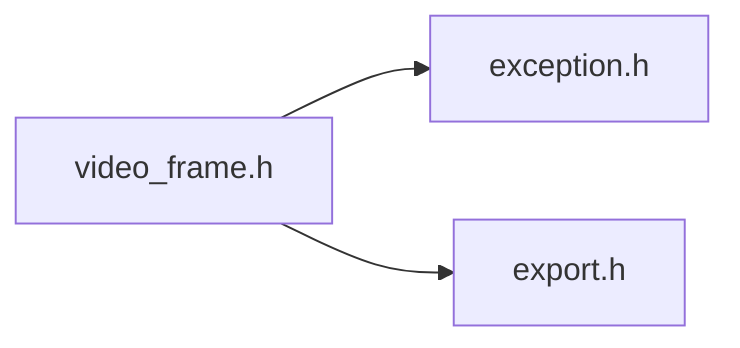
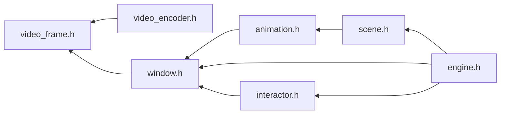

# File video_frame.h {/* #video__frame_8h */}

![][C++]

**Location**: `video\_frame.h`


## Classes

* [f3d::video\_frame](classf3d_1_1video__frame.md)
* [f3d::video\_frame::invalid\_frame\_exception](structf3d_1_1video__frame_1_1invalid__frame__exception.md)

## Namespaces

* [f3d](namespacef3d.md)

## Includes

* [exception.h](exception_8h.md)
* export.h





## Included by

* [video_encoder.h](video__encoder_8h.md)
* [window.h](window_8h.md)





## Source


```cpp
#ifndef f3d_video_frame_h
#define f3d_video_frame_h

#include "exception.h"
#include "export.h"

namespace f3d
{
class F3D_EXPORT video_frame
{
public:
  virtual ~video_frame() = default;

  virtual video_frame& setTimestamp(int64_t timestamp) = 0;

  struct invalid_frame_exception : public exception
  {
    explicit invalid_frame_exception(const std::string& what = "");
  };
};
}

#endif
```


[public]: https://img.shields.io/badge/-public-brightgreen (public)
[C++]: https://img.shields.io/badge/language-C%2B%2B-blue (C++)
[const]: https://img.shields.io/badge/-const-lightblue (const)
[protected]: https://img.shields.io/badge/-protected-yellow (protected)
[static]: https://img.shields.io/badge/-static-lightgrey (static)
[private]: https://img.shields.io/badge/-private-red (private)