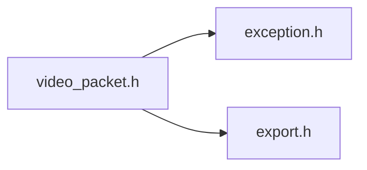

# File video_packet.h {/* #video__packet_8h */}

![][C++]

**Location**: `video\_packet.h`


## Classes

* [f3d::video\_packet](classf3d_1_1video__packet.md)

## Namespaces

* [f3d](namespacef3d.md)

## Includes

* [exception.h](exception_8h.md)
* export.h





## Included by

* [video_encoder.h](video__encoder_8h.md)


## Source


```cpp
#ifndef f3d_video_packet_h
#define f3d_video_packet_h

#include "exception.h"
#include "export.h"

namespace f3d
{
class F3D_EXPORT video_packet
{
public:
  virtual ~video_packet() = default;

  virtual size_t getPacketSize() const = 0;

  virtual std::byte* getPacketData() const = 0;

  virtual int64_t getTimestamp() const = 0;

  virtual bool isKeyFrame() const = 0;
};
}

#endif
```


[public]: https://img.shields.io/badge/-public-brightgreen (public)
[C++]: https://img.shields.io/badge/language-C%2B%2B-blue (C++)
[const]: https://img.shields.io/badge/-const-lightblue (const)
[protected]: https://img.shields.io/badge/-protected-yellow (protected)
[static]: https://img.shields.io/badge/-static-lightgrey (static)
[private]: https://img.shields.io/badge/-private-red (private)