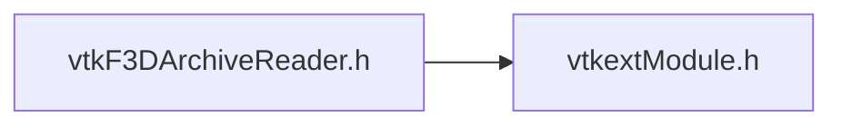

# File vtkF3DArchiveReader.h {/* #vtkF3DArchiveReader_8h */}

![][C++]

**Location**: `vtkF3DArchiveReader.h`


## Classes

* [vtkF3DArchiveReader](classvtkF3DArchiveReader.md)

## Includes

* vtkextModule.h





## Source


```cpp


#ifndef vtkF3DArchiveReader_h
#define vtkF3DArchiveReader_h

#include "vtkextModule.h"

#include <vtkObject.h>

#include <memory>
#include <string>
#include <vector>

class vtkResourceStream;

class VTKEXT_EXPORT vtkF3DArchiveReader : public vtkObject
{
public:
  static vtkF3DArchiveReader* New();
  vtkTypeMacro(vtkF3DArchiveReader, vtkObject);
  void PrintSelf(ostream& os, vtkIndent indent) override;

  bool Open(vtkResourceStream* stream);

  void Close();

  bool Has(const std::string& name);

  bool Extract(const std::string& name, std::vector<char>& out);

protected:
  vtkF3DArchiveReader();
  ~vtkF3DArchiveReader() override;

private:
  vtkF3DArchiveReader(const vtkF3DArchiveReader&) = delete;
  void operator=(const vtkF3DArchiveReader&) = delete;

  class vtkInternals;
  std::unique_ptr<vtkInternals> Internals;
};

#endif
```


[C++]: https://img.shields.io/badge/language-C%2B%2B-blue (C++)
[public]: https://img.shields.io/badge/-public-brightgreen (public)
[static]: https://img.shields.io/badge/-static-lightgrey (static)
[protected]: https://img.shields.io/badge/-protected-yellow (protected)
[private]: https://img.shields.io/badge/-private-red (private)