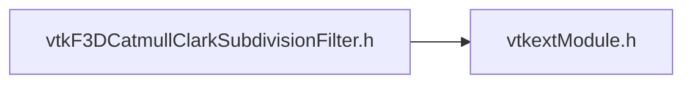

# File vtkF3DCatmullClarkSubdivisionFilter.h {/* #vtkF3DCatmullClarkSubdivisionFilter_8h */}

![][C++]

**Location**: `vtkF3DCatmullClarkSubdivisionFilter.h`


## Classes

* [vtkF3DCatmullClarkSubdivisionFilter](classvtkF3DCatmullClarkSubdivisionFilter.md)

## Includes

* vtkextModule.h





## Source


```cpp

#ifndef vtkF3DCatmullClarkSubdivisionFilter_h
#define vtkF3DCatmullClarkSubdivisionFilter_h

#include <vtkSubdivisionFilter.h>

#include "vtkextModule.h"

class VTKEXT_EXPORT vtkF3DCatmullClarkSubdivisionFilter : public vtkSubdivisionFilter
{
public:
  static vtkF3DCatmullClarkSubdivisionFilter* New();
  vtkTypeMacro(vtkF3DCatmullClarkSubdivisionFilter, vtkSubdivisionFilter);

protected:
  vtkF3DCatmullClarkSubdivisionFilter();
  ~vtkF3DCatmullClarkSubdivisionFilter() override;

  int RequestData(vtkInformation*, vtkInformationVector**, vtkInformationVector*) override;

private:
  vtkF3DCatmullClarkSubdivisionFilter(const vtkF3DCatmullClarkSubdivisionFilter&) = delete;
  void operator=(const vtkF3DCatmullClarkSubdivisionFilter&) = delete;
};

#endif
```


[C++]: https://img.shields.io/badge/language-C%2B%2B-blue (C++)
[public]: https://img.shields.io/badge/-public-brightgreen (public)
[static]: https://img.shields.io/badge/-static-lightgrey (static)
[protected]: https://img.shields.io/badge/-protected-yellow (protected)
[private]: https://img.shields.io/badge/-private-red (private)